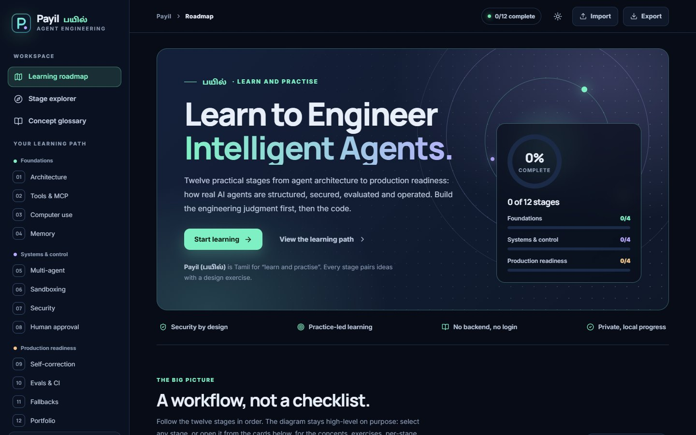
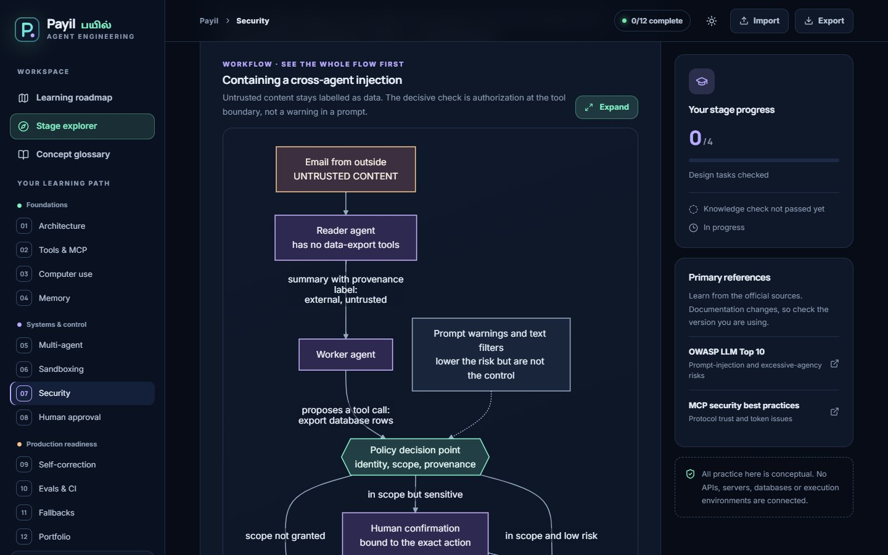
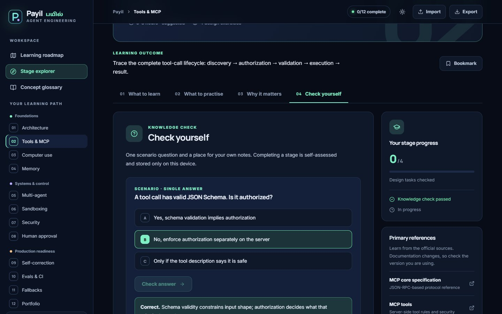
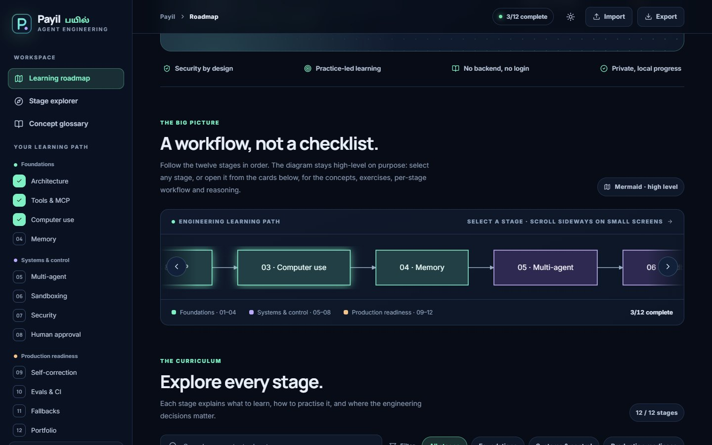
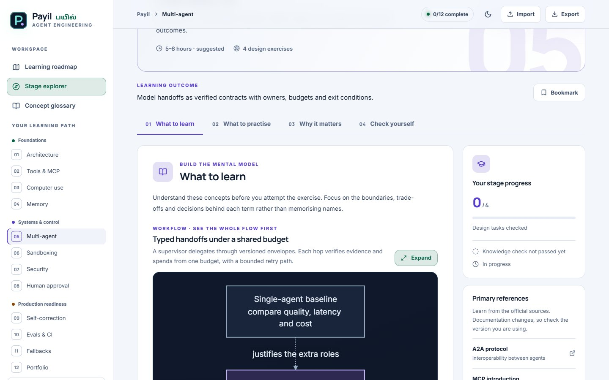
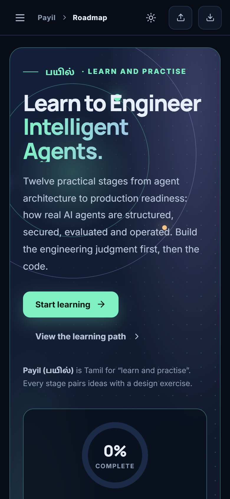
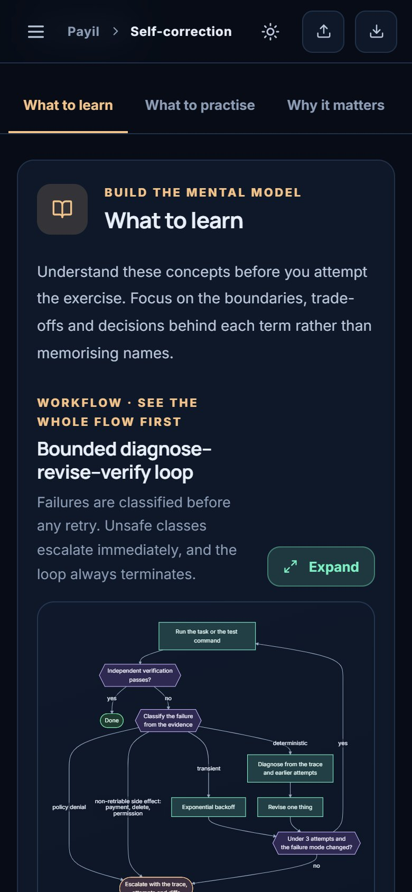

<div align="center">

# Payil · பயில்

### Learn to Engineer Intelligent Agents.

**Payil** (*பயில்*) is Tamil for **“learn and practise”**. It is a free, self-paced, interactive platform that teaches how real-world
AI agents are **architected, secured, evaluated and operated**, across twelve stages, with a Mermaid workflow for every stage.

[](https://github.com/itsual/payil-agent-engineering/actions/workflows/ci.yml)
[](https://github.com/itsual/payil-agent-engineering/actions/workflows/pages.yml)


[](LICENSE)
[](LICENSING.md)

### [▶ Open the live site](https://itsual.github.io/payil-agent-engineering/)



</div>

> **Learning-only edition.** The practice tasks are *design exercises*, not runnable systems. Nothing connects to a model, a
> database, a sandbox or the network. No account, no tracking: progress, notes and bookmarks live in your browser.

## What you get

| | |
|---|---|
| **Twelve stages, three phases** | Foundations (01–04), Systems & control (05–08), Production readiness (09–12), each with *What to learn · What to practise · Why it matters · Check yourself*. |
| **Mermaid workflows** | A high-level 12-node learning path (every node opens its stage), plus a dedicated workflow diagram inside each stage, with an *Expand* viewer. |
| **Detailed guides** | 4 concepts, 4 design exercises, 3 deliverables, rationale, a production guardrail and primary references per stage. |
| **Quizzes** | One scenario-based knowledge check per stage with explanations. Correct answers are remembered. |
| **Progress tracking** | Completion, task checklists, bookmarks, notes, per-phase progress. Export to and import from JSON. Reset with confirmation. |
| **Search and glossary** | Search every stage by concept, task or term. A 36-term glossary linked back to the stage that teaches each term. |
| **Polished and accessible** | Responsive from phone to desktop, dark and light themes, keyboard-operable tabs, dialogs and diagram nodes, reduced-motion support. |
| **Ready to grow** | Content is data. A validated extension point for hands-on labs and worked examples is already in place. |

<table>
  <tr>
    <td width="50%"></td>
    <td width="50%"></td>
  </tr>
  <tr>
    <td></td>
    <td></td>
  </tr>
</table>

<p align="center"> &nbsp; </p>

## The curriculum

| # | Stage | Phase | You will be able to… |
|---:|---|---|---|
| 01 | Agent architecture & state machines | Foundations | Explain how a request flows through a graph and how execution resumes safely after interruption. |
| 02 | Tool use & Model Context Protocol | Foundations | Trace the tool-call lifecycle: discovery → authorization → validation → execution → result. |
| 03 | Computer use & GUI automation | Foundations | Choose between semantic DOM actions and guarded visual interactions. |
| 04 | Advanced memory & context engineering | Foundations | Design a memory lifecycle with retention, retrieval, summarization and deletion rules. |
| 05 | Multi-agent coordination & A2A handoffs | Systems & control | Model handoffs as verified contracts with owners, budgets and exit conditions. |
| 06 | Sandboxed execution environments | Systems & control | Produce an isolation design that fails safely under malicious or runaway workloads. |
| 07 | Inter-agent security & guardrails | Systems & control | Trace and constrain a cross-agent prompt-injection attempt with enforceable controls. |
| 08 | Human-in-the-loop & durable breakpoints | Systems & control | Specify a paused workflow that resumes safely after a long delay or restart. |
| 09 | Self-correction & bounded reflection | Production readiness | Design a bounded diagnose → revise → verify cycle with useful escalation. |
| 10 | Trajectory evaluations & CI quality gates | Production readiness | Define a reproducible, risk-weighted evaluation suite for tool actions and trajectories. |
| 11 | Graceful degradation & intelligent fallbacks | Production readiness | Define safe fallback routing that makes failure visible and preserves permissions. |
| 12 | Public teardowns & engineering portfolio | Production readiness | Publish a credible, security-conscious case study others can inspect and reproduce. |

The lessons deliberately correct common overstatements: checkpoints do not make external side effects exactly-once; schema
validation is not authorization; swarms need a simpler baseline to beat; containers are not automatically microVMs; text
sanitisation is not a security boundary; an HTTP 404 does not justify scraping; and published benchmarks need denominators.

## Quick start

Requires **Node.js 22+** and npm.

```bash
git clone https://github.com/itsual/payil-agent-engineering.git
cd payil-agent-engineering
npm install
npm run dev          # http://localhost:5173
```

| Command | What it does |
|---|---|
| `npm run dev` | Start the dev server with hot reload. |
| `npm run check:content` | Validate the curriculum, diagrams, glossary, labs and repository hygiene (dependency-free). |
| `npm run check:links` | Check that every reference link in the lessons still resolves (needs network; also runs monthly in CI). |
| `npm run typecheck` | TypeScript in strict mode. |
| `npm test` | Unit and component tests (Vitest + Testing Library): progress, routing, search, user journeys, parsing every Mermaid diagram, palette contrast and structural accessibility (axe-core). |
| `npm run build` | Type-check and produce the static site in `dist/`. |
| `npm run verify` | All of the above in order: the same gate CI runs. |
| `npm run preview` | Serve the production build locally. |

## Deploy to GitHub Pages

The site is a static bundle, and `.github/workflows/pages.yml` deploys it automatically.

1. Push to the `main` branch of your repository.
2. In **Settings → Pages → Build and deployment**, set **Source** to **GitHub Actions** (one-time).
3. Every push to `main` runs *check → type-check → test → build* and publishes `dist/`. The URL appears in the workflow run and
   under Settings → Pages. For this repository it is `https://<user>.github.io/payil-agent-engineering/`.

`vite.config.ts` uses `base: './'`, so the same build also works at a domain root or any sub-path. Routes are hash-based, so no
server rewrite rules are needed.

**Forking?** Update the repository and site URLs in [`src/config.ts`](src/config.ts) and the canonical and social tags in
[`index.html`](index.html).

## Project structure

```text
payil-agent-engineering/
├── .github/            workflows (ci, pages, monthly link check) and dependabot
├── content/
│   ├── labs/           future hands-on labs (lab.json manifests are validated and rendered)
│   └── examples/       future worked examples
├── docs/               ARCHITECTURE · CONTENT_MODEL · EXTENDING · BUILD_SPEC · screenshots
├── public/             favicon, social preview image, THIRD-PARTY-NOTICES.txt
├── scripts/            validate-content.mjs · check-links.mjs
├── LICENSE             MIT (code)
├── LICENSE-CONTENT.txt CC BY 4.0 (lessons)  ·  LICENSING.md explains which files are which
└── src/
    ├── App.tsx                 routing, state and dialogs wiring
    ├── config.ts               brand and URLs
    ├── components/             layout · roadmap · stage · glossary · diagram · dialogs · common
    ├── hooks/                  useRoute · useProgress · useTheme · useMediaQuery
    ├── lib/                    progress · route · search · mermaid · dom   (pure, unit-tested)
    ├── data/
    │   ├── stages.json         the curriculum (single source of truth)
    │   ├── workflows/*.mmd     one Mermaid diagram per stage
    │   ├── roadmap.mmd         the high-level 12-stage path
    │   ├── glossary.json       36 terms
    │   └── types.ts · phases.ts · labs.ts · stages.ts
    └── styles/                 tokens · base · layout · roadmap · stage · glossary · fonts
```

More detail: [Architecture](docs/ARCHITECTURE.md) · [Content model](docs/CONTENT_MODEL.md) · [Extending Payil](docs/EXTENDING.md) ·
[Build specification](docs/BUILD_SPEC.md) · [Contributing](CONTRIBUTING.md).

## Editing the curriculum

Everything a learner reads lives in `src/data`. Edit `stages.json`, run `npm run verify`, and look at the stage in
`npm run dev`. To change a stage's diagram, edit `src/data/workflows/<slug>.mmd`. The validator and tests guard the structure:
twelve ordered stages, valid quizzes, https references, a diagram per stage that parses with the real Mermaid parser, and
no leftover trace of the product's earlier working title. See the [content model](docs/CONTENT_MODEL.md).

## Privacy and security

- No backend, no cookies, no analytics, no third-party requests (fonts are bundled).
- Progress is stored in `localStorage` under `payil:progress:v1` and never leaves your device unless you export it yourself.
- Mermaid runs in `strict` security mode, and diagram sources are repository-owned. Imported progress files are validated and sanitised.
- Outbound reference links open in a new tab with `rel="noreferrer"`.

## Status and known limitations

- **Learning-only.** Practice is conceptual; there are no runnable labs yet (the extension point exists).
- Progress is per browser. Use *Export* and *Import* to move it between devices.
- Suggested hours are estimates, not promises. Nothing here guarantees a job or a security outcome.
- Reference links point to third-party documentation that changes; check the version you use. The MCP lessons reference the
  2026-07-28 specification revision. All 25 links were verified (HTTP 200, no redirects) on 2026-10-19 with
  `npm run check:links`, and a scheduled workflow re-checks them monthly.
- **Accessibility.** Audited with axe-core (WCAG 2.0/2.1/2.2 A and AA plus best practices) in a real browser across 82
  view-and-state combinations (every view and tab, dialogs, quiz feedback, both themes, desktop and phone): 0 violations. A
  keyboard-only walkthrough covers the skip link, tab order, roadmap nodes, arrow-key tabs, and dialog focus trapping and
  restore. Text colours are held to 4.5:1 by unit tests, including hover tints and the diagram palette. **Not done:** testing
  with real screen readers (NVDA, JAWS, VoiceOver, TalkBack), a manual WCAG review, or user testing with disabled people.
  Automated tools find only part of the issues, so treat this as a strong baseline rather than a certification.
- Verified in a Chromium-based browser (Edge) at desktop, tablet and phone sizes in both themes. Firefox and Safari have not
  been tested.

## Roadmap

1. **Hands-on labs and worked examples**, stage by stage, through `content/labs` (isolated, synthetic, opt-in).
2. **Richer lessons** in MDX, with the same stable stage ids.
3. **Guarded exercises** with evaluator-backed checks in an isolated service.
4. **Community:** opt-in sync and reviewed public teardowns, after a privacy policy exists.

## License

Payil is open under two licenses, one per kind of material:

- **Code: [MIT](LICENSE).** The app, tests, scripts, styles, workflows and build configuration.
- **Lessons: [CC BY 4.0](LICENSE-CONTENT.txt).** The curriculum, quizzes, glossary, Mermaid diagrams, docs and screenshots. Reuse
  and adapt them, including commercially, with credit to *Payil (பயில்) by Arockia Liborious*, a link to the license, and a note of
  any changes.

[`LICENSING.md`](LICENSING.md) lists exactly which files fall under which license and gives a ready-made credit line. Fonts and
libraries bundled into the site keep their own licenses; the required notices ship with the site at
[`THIRD-PARTY-NOTICES.txt`](public/THIRD-PARTY-NOTICES.txt).
